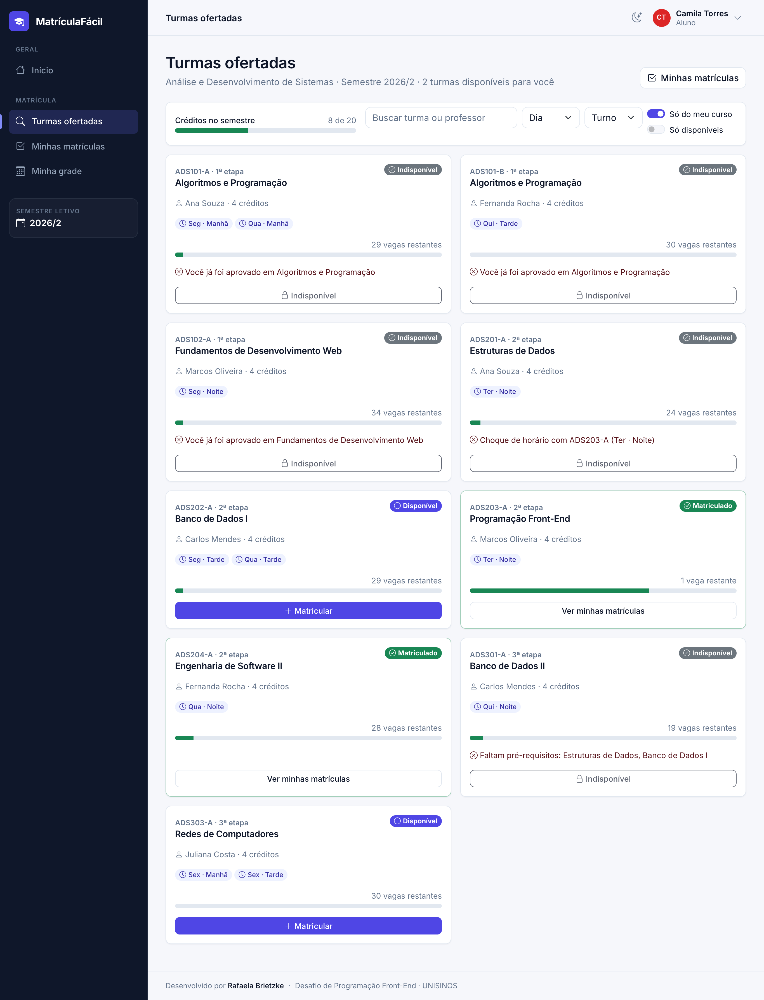
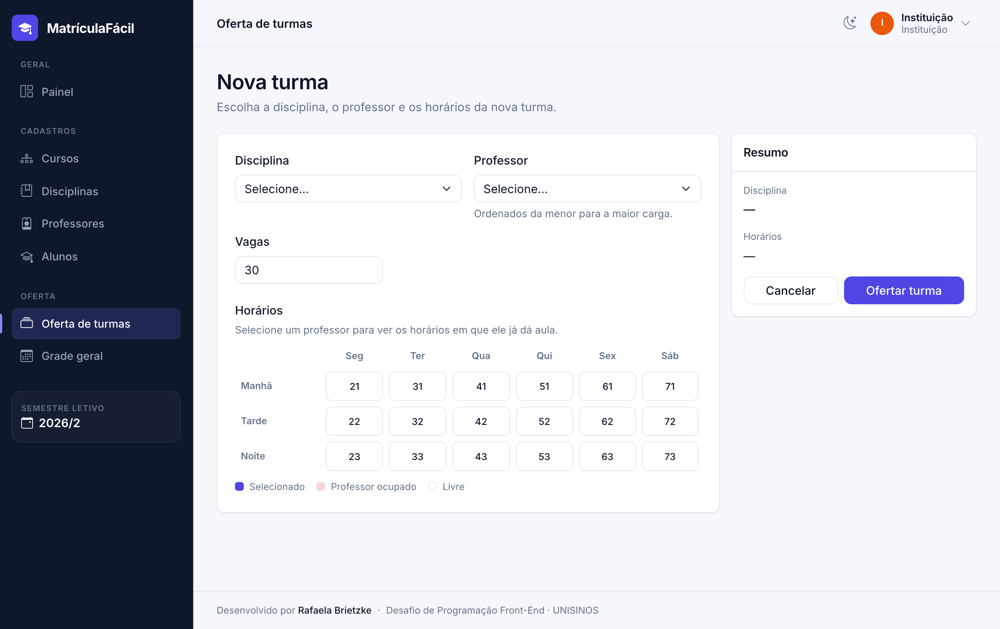
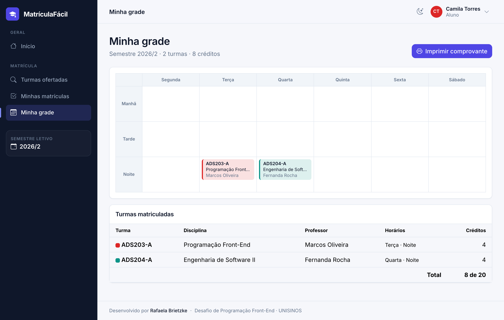

# MatrículaFácil — Sistema de Atendimento e Matrículas

Desafio da Atividade Acadêmica de Programação Front-End (UNISINOS, Análise e Desenvolvimento de Sistemas, 2026/2).
Desenvolvido por **Rafaela Brietzke**.

O MatrículaFácil é uma aplicação web em que a **instituição** monta a oferta de turmas do semestre (disciplina + professor + horários + vagas) e os **alunos** se matriculam nelas. O sistema impede choque de horário, falta de pré-requisito, turma lotada e sobrecarga de professores, e sempre **explica o motivo** de cada bloqueio.



| | |
| --- | --- |
|  |  |

📄 **Documento de planejamento:** [docs/planejamento.pdf](docs/planejamento.pdf) (casos de uso, regras, telas, rotas, arquitetura, modelo de dados e API).

🎬 **Vídeo de apresentação:** [docs/video-apresentacao-final.mp4](docs/video-apresentacao-final.mp4) (execução do sistema e partes principais do código).

## Funcionalidades

**Instituição**

- Cadastro de cursos (com matriz curricular por etapa), disciplinas (com pré-requisitos), professores e alunos.
- Oferta de turmas com grade de horários clicável, controle da carga dos professores e código da turma gerado pelo servidor.
- Grade geral do semestre, com filtros por professor e por disciplina.
- Perfis do professor (carga, turmas e agenda) e do aluno (concluídas, em curso e faltam cursar).
- Abertura e fechamento do período de matrícula.

**Aluno**

- Turmas ofertadas com o status de cada uma e todos os motivos de bloqueio.
- Matrícula com prévia da grade e cancelamento.
- Grade semanal e comprovante de matrícula para impressão.

**Geral:** login simulado por perfil com rotas protegidas, tema claro e escuro e layout para celular.

## Regras de matrícula

| # | Bloqueia quando |
| - | --------------- |
| 1 | O período de matrícula está fechado |
| 2 | A disciplina não está na matriz do curso do aluno |
| 3 | O aluno já foi aprovado na disciplina |
| 4 | O aluno já está em outra turma da mesma disciplina |
| 5 | Falta algum pré-requisito |
| 6 | A turma está lotada |
| 7 | Algum horário coincide com uma turma em que o aluno já está |
| 8 | Os créditos passariam do limite do semestre |

As regras ficam no servidor (que recusa com `409` e o motivo), e a tela recebe os bloqueios já calculados para desabilitar o botão antes do clique.

## Tecnologias

| Camada | Tecnologias |
| ------ | ----------- |
| Front-end | React 19, Vite, React Router, Bootstrap 5 + Bootstrap Icons, `fetch` + `async/await`, Context API, Error Boundary |
| Back-end | Node.js 22, Express 5, persistência em arquivo JSON |
| Testes | `node:test` (back-end) |

Toda a interface é renderizada no navegador. O back-end só fornece dados em JSON.

## Como executar

Pré-requisito: **Node.js 22** ou superior.

### 1. Back-end (API na porta 3001)

```bash
cd backend
npm install
npm run seed   # cria/restaura os dados de demonstração
npm run dev    # inicia a API em http://localhost:3001/api
```

### 2. Front-end (porta 5173)

Em outro terminal:

```bash
cd frontend
npm install
npm run dev    # abre em http://localhost:5173
```

## Demonstração

O login é simulado: na tela inicial, escolha **Instituição** ou um dos alunos. Os dados do seed já trazem cenários prontos:

- **Camila Torres:** vê turmas bloqueadas por choque de horário, por já ter sido aprovada e por falta de pré-requisito.
- **Gabriela Nunes:** ao se matricular em `ADS203-A`, a turma lota (3/3).
- **Hugo Alves** (Jogos Digitais): as turmas de ADS aparecem bloqueadas por estarem fora do curso dele.
- **Instituição:** ao fechar o período de matrícula no painel, os alunos passam a só consultar.

Para voltar aos dados originais a qualquer momento, rode `npm run seed` na pasta `backend`.

## Testes e qualidade

```bash
cd backend
npm test        # 88 testes automáticos

cd frontend
npm run lint    # sem erros e sem avisos
npm run build   # build de produção
```

Os testes cobrem as 8 regras de matrícula, de oferta, de cadastros e da matriz curricular, as rotas da API sobre um banco temporário, a leitura e gravação do arquivo, a migração de dados antigos e a coerência do seed.

## Estrutura

```
backend/
  data/seed.json          dados de demonstração
  scripts/seed.js         restaura o db.json a partir do seed
  src/app.js              montagem da API (rotas e middlewares)
  src/db.js               leitura e gravação do arquivo JSON
  src/migracoes.js        atualiza um db.json antigo sem perder dados
  src/regras/             regras de negócio (funções puras)
  src/rotas/              rotas REST por recurso
  test/                   testes automáticos (node:test)
frontend/
  src/api/cliente.js      chamadas HTTP (fetch)
  src/contexto/           sessão e notificações (Context API)
  src/hooks/              useBuscaDados, useTema
  src/componentes/        layout, grade horária, modais, painel lateral…
  src/paginas/            telas da instituição e do aluno
  src/utilitarios/        horários, cores, indicadores
  src/estilos/            tema (claro/escuro) e layout
docs/
  planejamento.md / .pdf  documento de planejamento
  telas/                  prints da aplicação
```
